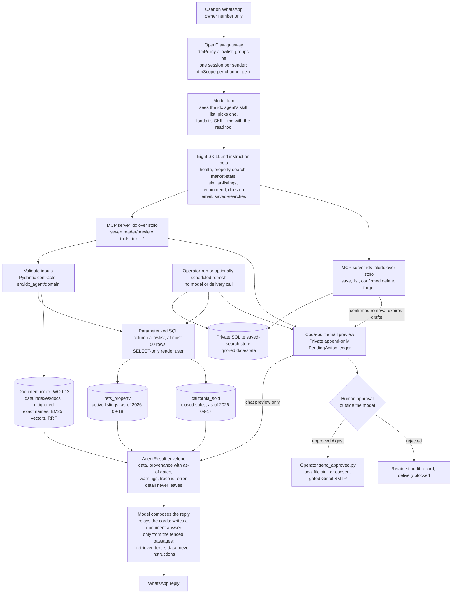

# Architecture

Current implemented architecture, including the owner-only alert extension.
Read STATUS.md for verification dates and remaining live acceptance.

## 1. Request path
As decided in ADR-0003 and confirmed by the WO-001 live run. Solid nodes exist today;
the email preview and operator approval path is implemented in WO-015.

Facts fixed by config, not by prompt: the tool policy, the sender allowlist, the session
scope, and the MCP launch are all in `config/openclaw.idx.json5`. Memory flush and the
dreaming job are off for this agent, so conversation facts are not copied into
workspace files. The model never touches the database; every arrow below the MCP node is
code with tests.

## 2. Components
**Channel.** OpenClaw links WhatsApp through WhatsApp Web with the owner's allowlist.
A dedicated number is not a release claim. The local Control UI uses the owner-only
dashboard memory bucket. The channel is an adapter; no business logic lives in it.

**Runtime.** A skill is a folder with a `SKILL.md`: a one-line description the model
matches on, plus instructions. The model picks a skill, then acts through tools. Our
tools are exposed through two stdio MCP servers, with the
shell tool disabled for the user-facing agent. OpenClaw keeps its own sessions; which
state lives where is decided in WO-001.

**Routing.** The model chooses among skills (OpenClaw's native routing); each skill's
instructions select the appropriate typed tool for each operation, and our code owns
everything below that boundary. Most skills have one tool; saved-searches has four.
A router behind a single entry tool was rejected as a second model call per message; it
returns only if the WO-004 routing evals demand it. Decided in
`adrs/0003-routing-and-tool-route.md`. Since WO-013 the routing rules are written down as
a contract, `docs/ROUTING.md` (one row per intent: skill, tool, an example, the hand-off
rule for mixed messages, "show me more" after any tool, term questions to docs-qa, the
email decline, instruction-like text as data), expressed in the skills' own text and
checked by model-free tests (`tests/test_routing_contract.py`) plus a mixed-intent
`local` suite run through the eval driver's routing mode.

**The five agent roles** (functions in one codebase, not processes):

| Role | Owns | Tools | Data |
|---|---|---|---|
| search | filters -> bounded listing results, refinement | `search_listings` | rets_property |
| market | medians, opt-in means/inventory/monthly changes, labels | `get_market_stats` | california_sold; rets_property for current inventory |
| recommendation | similar listings, comp-checked price | `find_similar_listings` (WO-010), `recommend` (WO-011) | rets_property plus the remarks index; both tables for `recommend` (bathrooms never compared) |
| rag | grounded answers with sources | `rag_answer` (WO-012) | the document index (no database connection) |
| email | prepares property/report/digest previews and alert drafts; operator approves/delivers | `draft_email`; four `idx_alerts` management tools; separate approval/send commands | re-fetched results, private SQLite filters, append-only approval ledger |

**Shared layer.**
- Contracts, `src/idx_agent/domain/`: the only way data crosses a boundary.
- Data access, `src/idx_agent/db/`: parameterized SQL, column allowlist, row cap, SELECT-only user, as-of dates.
- MCP server, `src/idx_agent/mcp_server/`: typed tools over data access and analytics.
- Session state, `src/idx_agent/memory/`: process-local search state, including the
  dashboard bucket. Persistent saved filters live separately in `alerts/` SQLite.
- Safety, `src/idx_agent/safety/`: allow/deny lists, approval state machine, redaction.
- Observability, `src/idx_agent/observability/`: redacted logs, trace id and optional
  stage spans beside OpenClaw's chat/token spans in loopback Jaeger, plus a rotating
  log file. Actual billed cost comes from the provider console (TRACING.md, ADR-0006).
- Card relay boundary: ADR-0012 records the required byte-identical output path
  and gateway privilege boundary; implementation is blocked by the single-hook
  API constraint. No deterministic relay extension is currently installed.
- Evals, `evals/`: golden cases; script-checkable ones run in CI.

## 3. Data
- `rets_property`: active listings, 130+ columns. Core search fields use IDX legacy
  names (`L_City`, `L_Zip`, `L_SystemPrice`, `L_Keyword2` = beds, `LM_Dec_3` = baths,
  `LM_Int2_3` = sqft, `L_Type_` = subtype, `L_Remarks` with a FULLTEXT index,
  `L_Photos` JSON). Two status columns that agree on every row; `StandardStatus =
  'Active'` is the rule (WO-002), and the whole table is active listings (55,212 rows).
- `california_sold`: closed transactions from 2026-03-18 to 2026-09-17 (98,552 rows, about
  six months, not multiple years), RESO-style names (`ClosePrice`, `CloseDate`,
  `LivingArea`, `BedroomsTotal`, `PropertySubType`). Date columns are text; integer
  counts are stored as doubles; the table ships with no index. The migration adds real
  date columns and indexes. Both tables use the same RESO subtype vocabulary.
- Join: `CAST(rets_property.L_ListingID AS UNSIGNED) = california_sold.ListingKey`;
  market-level joins on city or postal code.
- Two as-of dates: sold = the latest `CloseDate` that is not after the active as-of date
  (2026-09-17; four typo rows sit in 2028-2072 and are excluded), active =
  `MAX(ModificationTimestamp)` (2026-09-18). Every time window counts back from these,
  never from today.
- Canonical names are RESO. The map lives in `docs/data/schema_notes.md` (WO-002) and
  `src/idx_agent/domain/fieldmap.py` (WO-003).
- Bathrooms differ across tables (decimal vs integer count) and are never compared.
- Remarks index (WO-010, ADR-0007): OpenAI `text-embedding-3-small` vectors of active
  `L_Remarks`, built once offline, stored as NumPy files beside each listing's key, city,
  price, beds, and subtype, under the gitignored `data/indexes/remarks/` only. Loaded once
  per MCP server process by `find_similar_listings`, which ranks by cosine similarity in
  code and re-checks the winners in SQL. `recommend` (WO-011) shares the loaded index and
  ranks by a listing's own stored vector, so it embeds nothing. No vector database, and
  FULLTEXT stays unused.
- Document index (WO-012, ADR-0009): the reference documents chunked by code (the
  Trestle field guide per field, the Primer per section, our schema notes per section plus
  one column summary per table, our own-words glossary per term, and the saved Week 5
  market summaries per city), with no chunk for a deny-listed or agent-contact field.
  Stored as `chunks.jsonl`, `meta.json`, and (hybrid) `vectors.npy` under the gitignored
  `data/indexes/docs/` only, since the two PDFs are confidential. Loaded once per MCP
  server process by `rag_answer` from `IDX_RAG_INDEX_DIR`. Retrieval is code: an exact
  field name or alias first, then BM25 and the embedding ranks fused by reciprocal rank,
  then the not-found floors from the index meta (or `IDX_RAG_FLOOR_BM25` and
  `IDX_RAG_FLOOR_COSINE` when set, so a floor changes without a rebuild). The tool
  never opens a database connection; its result names no table and no as-of date.
- Sensitive columns may exist among the undocumented ones; see the deny-list in
  `SAFETY_INVARIANTS.md`.

## 4. Where code lives vs where it runs
OpenClaw runs from its own install. Its private state directory holds the rendered
configuration. It loads this checkout's `skills/` in place through extraDirs;
there are no copied or symlinked skill files to keep synchronized. The installer
configures both MCP servers, preserves existing provider settings, and adds tracing
only when configured. OpenClaw's source is never vendored here. Runtime policy
allows `idx__*`, `idx_alerts__*` and `read`, with shell, file writes, web/browser,
cross-session messaging and model-controlled scheduling denied.

## 5. Deliberately absent until evidence says otherwise
Vector database, reranker, model router with confidence, memory beyond sessions
(apart from the bounded saved-search filters in ADR-0008),
queues, deployment, fine-tuning. Gates are in `DECISIONS.md`.

## 6. Open points
Provider migration and fresh live acceptance; operator email delivery; optional
alert scheduling; final recording/reflection; additional history for full-year
comparisons. Earlier routing/session decisions are recorded, not open design work.

## 7. Saved-search writer and additive metrics (WO-009)

`idx_alerts` is a second stdio MCP process with save/list/delete/forget tools and
the saved-searches skill. It owns a private SQLite file under ignored data/state,
separate from MLS credentials and the in-process search memory. The reader process
does not import the alert writer or read its path setting. A manual or operator-
scheduled job uses the SELECT-only listing builder and dated new-listing rule,
then the existing append-only approval journal. It never imports delivery code.
Transactions serialize refresh/removal; idempotency bridges interruptions between
the journal and SQLite. ADR-0008 records the limits and identity assumptions.

Extended market requests add three bounded aggregate statements over the same
cleaned sales and a current inventory count; default requests keep the original
statements. Rich property/digest email sources reuse the comp and stored-vector
recommendation paths. Photo URLs come from the allowlisted feed, remain in the
approved body, and are rendered as escaped HTML only by the operator transport.
